# Khảo sát giao diện: đại học, phòng thí nghiệm, nền tảng học — 2026-11-10

> Mục đích: lấy **nguyên tắc có số đo** cho EDUVN v2 (hai cổng GV / HS-SV). Không sao chép logo, ảnh, nhận diện hay bố cục nguyên trang của ai.
> Ảnh thu nhỏ: `docs/research/ui-survey/*.webp` (720 px, ≤ 60 KB/ảnh, tổng ≈ 0,7 MB).

## 1. Cách đo

| Bước | Công cụ | Đo gì |
|---|---|---|
| 1 | **REA `capture_browser_scenario`** (Chrome 1440×900, chờ 4 s, `events: network, page-errors`, `at_end: screenshot`) — mỗi trang một lần chạy, tuần tự, đóng trình duyệt sau mỗi lần | Số request theo loại, số request lỗi, số origin, ảnh màn hình (PNG có SHA-256) → Evidence ID ở bảng 3 |
| 2 | Playwright + `getComputedStyle` + `PerformanceObserver` (cùng Chrome, một trình duyệt cho cả lượt) | Font/cỡ/giãn dòng của thân, tiêu đề, đoạn văn; bề rộng đoạn → ký tự/dòng; khung nội dung; màu chữ/nền chiếm diện tích lớn nhất; bo góc nút; thời lượng + easing transition; có `prefers-reduced-motion` không; KB JS/tổng, DOM, LCP, CLS; tràn ngang ở 390 px |
| 3 | Đo riêng 2 trang dữ liệu (OWID Grapher, Distill bài viết) | Chữ trục, nét lưới, nét đường, chú thích hình |

**Giới hạn.** Trang chủ (trừ Distill bài viết, OWID Grapher) — không phải màn ứng dụng sau đăng nhập; Canvas LMS chỉ đo trang giới thiệu (dashboard cần tài khoản). **Oxford bị loại**: trả về trang kiểm tra bot (7 request, 47 nút DOM). LCP đo headless trên mạng nhà, chỉ dùng để **so sánh tương đối**. `KB JS = n/a` khi tài nguyên khác origin không gửi `Timing-Allow-Origin` (transferSize = 0). Nhiều trang hiện banner cookie trong ảnh.

## 2. Bảng số đo (26 trang hợp lệ)

Nhóm: ĐH = 8 trang · Lab/nhà nghiên cứu/dữ liệu = 13 · Học tập/công cụ = 5. "Đoạn" = đoạn văn > 60 ký tự đầu tiên; ký tự/dòng ≈ bề rộng ÷ (0,5 × cỡ chữ).

| Trang | Font thân / tiêu đề | Thân px/lh | Tiêu đề px | Đoạn: rộng px · ký tự/dòng | Khung px | Req (REA) | Bên thứ 3 | JS KB | DOM | LCP ms | CLS | Motion phổ biến | reduced-motion |
|---|---|---|---|---|---|---|---|---|---|---|---|---|---|
| MIT | neue-haas-grotesk-te / neue-haas-grotesk- | 17/27 | 47 | 453 · 28 | full | 26 | 3 | 383 | 382 | 1448 | 0.001 | 0.6s, 0.3s | không |
| Stanford | Source Sans 3 / Source Sans 3 | 20/30 | 14 | 549 · 55 | full | 99 | 12 | 630 | 1397 | 656 | 0 | 0.15s, 0.3s | có |
| Harvard | GT America Standard  / GT America Standar | 18/27 | 36 | 560 · 62 | 1344 | 62 | 14 | 389 | 1235 | 1368 | 0 | 0.15s, 1.2s | không |
| Cambridge | Lato / open sans | 16/24 | 16 | 544 · 76 | 1280 | 54 | 9 | 110 | 529 | 1052 | 0.001 | 0.15s, 0.2s | có |
| ETH Zürich | DINPro / DINPro | 16/normal | 20 | 341 · 34 | 1344 | 43 | 3 | 760 | 1045 | 4400 | 0.602 | 0.08s, 0.16s | không |
| EPFL | SuisseIntl / SuisseIntl | 18/27 | 48 | 326 · 36 | 1376 | 48 | 6 | 173 | 1956 | 2256 | 0.002 | 0.2s, 0.15s | có |
| NUS | Roboto / Roboto | 14/20 | 40 | 536 · 60 | 1170 | 79 | 9 | 135 | 870 | 3068 | 0.963 | 0.2s, 0.4s | có |
| U Tokyo | Roboto / Roboto | 10/10 | 28 | 260 · 32 | 1300 | 114 | 7 | 122 | 1032 | 4652 | 0.355 | 0.3s, 0.5s | không |
| MIT Media Lab | Neue Haas Grotesk Te / Neue Haas Grotesk  | 16/16 | 16 | 253 · 40 | 1380 | 46 | 6 | 1897 | 1134 | 2812 | 0.002 | 0.3s | có |
| Stanford HAI | Times New Roman / circularMedium | 18/24 | 58 | 556 · 62 | 1392 | 90 | 7 | 439 | 1644 | 1100 | 0 | 0.1s, 0.15s | có |
| Max Planck | Roboto / Merriweather | 16/27 | 34 | 505 · 63 | 1300 | 45 | 6 | 133 | 1863 | 1752 | 0.041 | 0.25s, 0.5s | không |
| Ai2 | telegraf / telegraf | 16/normal | 36 | 373 · 47 | 1280 | 31 | 1 | 730 | 1895 | 2864 | 0 | 0.5s, 0.3s | có |
| DeepMind (research) | Google Sans Flex / Google Sans Flex | 18/25 | 54 | 400 · 25 | 1296 | 166 | 14 | 110 | 1862 | 980 | 0.001 | 0.2s, 0.15s | không |
| Distill (index) | -apple-system / -apple-system | 16/25 | 26 | 394 · 49 | 984 | 38 | 2 | n/a | 462 | 376 | 0 | — | không |
| Distill (bài) | -apple-system / HoeflerText-Regula | 16/25 | 56 | 648 · 65 | 986 | 29 | 2 | 120 | 43004 | 580 | 0 | — | không |
| Karpathy | sans-serif / sans-serif | 16/22 | 34 | — · — | 1000 | 45 | 0 | 0 | 467 | 268 | 0.014 | — | không |
| Bret Victor | Avenir / Avenir | 13/16 | 19 | 534 · 89 | full | 5 | 0 | 0 | 518 | 1276 | 0.012 | — | không |
| colah (C. Olah) | CMS / CMS | 18/27 | 27 | 806 · 90 | 1170 | 64 | 8 | 83 | 367 | 948 | 0.01 | — | không |
| Our World in Data | Lato / Playfair Display | 16/26 | 32 | 519 · 74 | 1280 | 36 | 5 | 1031 | 1679 | 700 | 0.002 | 0.2s, 0.125s | có |
| OWID Grapher | Lato / Playfair Display | 16/26 | 25 | 880 · 117 | 1280 | 26 | 6 | 1030 | 4378 | 796 | 0.017 | 0.1s, 0.15s | có |
| Observable | Inter Variable / — | 16/24 | — | 585 · 69 | 1152 | 389 | 6 | 863 | 2936 | 1704 | 0.086 | 0.75s, 0.15s | có |
| Brilliant | CoFo Brilliant / CoFo Robert | 16/24 | 54 | 443 · 49 | 1306 | 164 | 20 | 1866 | 1202 | 3504 | 0.023 | 0.75s, 0.3s | có |
| Khan Academy | Plus Jakarta Sans / Plus Jakarta Sans | 14/20 | 42 | 480 · 60 | 1248 | 85 | 3 | n/a | 731 | 1424 | 0.204 | 0.1s, 0.15s | không |
| Coursera | Source Sans Pro / Source Sans Pro | 16/24 | 48 | 225 · 32 | 1376 | 137 | 5 | 1097 | 2198 | 852 | 0.005 | 0.3s, 0.15s | có |
| Canvas (Instructure) | circularxx / circularxx | 16/26 | 40 | 642 · 64 | 1280 | 253 | 67 | 687 | 1934 | 3540 | 0 | 0.5s, 0.4s | có |
| Linear | Inter Variable / Inter Variable | 16/24 | 64 | 505 · 67 | 1344 | 414 | 5 | n/a | 4874 | 2808 | 0 | 0.1s, 0.16s | có |

**Tổng hợp nhanh**

| Chỉ số | ĐH | Lab / dữ liệu | Học tập / công cụ |
|---|---|---|---|
| Request (trung vị, REA) | 58 | **45** | 164 |
| LCP (trung vị) | 1 852 ms | **980 ms** | 2 808 ms |
| DOM (trung vị) | 1 039 | 1 679 | 1 934 |

- Cỡ chữ đoạn văn trung vị **17 px**; ký tự/dòng trung vị **60** (dải 55–70 ở các trang dễ đọc: Harvard 62, Distill bài 65, Linear 67, Observable 69).
- Trang đọc dài của nhà nghiên cứu dùng **serif cho nội dung**: Distill bài viết Georgia 20/31 px, colah 18/27 px; tiêu đề serif ở Distill (56 px), OWID (Playfair), Max Planck (Merriweather). Công cụ dày dữ liệu dùng **sans biến thiên**: Linear, Observable = Inter.
- Màu chữ chính **không phải đen tuyệt đối**: #121317 (DeepMind), #1B1E23 (Observable), #0D0F12 (Coursera), #151521 (Khan), rgba(0,0,0,.8) (Distill). Chữ phụ xám-lam: #45474D, #48546E, #4A4C53.
- Bo góc nhỏ ở ĐH/lab: MIT 2, ETH 2, EPFL 2–5, Cambridge 4, DeepMind 4, Observable 4–6 px. Nút viên thuốc (9999 px) chỉ ở trang marketing (Ai2, Brilliant, Linear).
- Motion: thời lượng phổ biến **0,08–0,3 s** (Linear 0,1/0,16; ETH 0,08/0,16; Khan 0,1/0,15; Cambridge 0,15/0,2). Chỉ **14/26** trang có `prefers-reduced-motion`.
- Bố cục nhảy (CLS > 0,1): NUS 0,96 · ETH 0,60 · U Tokyo 0,36 · Khan 0,20 — đều là ảnh/khối tải muộn không giữ chỗ. Tràn ngang ở 390 px: ETH, NUS, Khan, Distill bài viết.
- Phụ thuộc bên thứ ba: Canvas 59 host, Brilliant 16 — trái ngược Karpathy 0, Bret Victor 0, Distill 2.
- Biểu đồ OWID Grapher: chữ trục **12 px** xám #5B5B5B, lưới **1 px #DDD** liền, nét trục #999; có tab **Bảng / Bản đồ / Đường** — mọi biểu đồ có bản bảng tương đương. Distill: chú thích hình **13 px**, rgba(0,0,0,.6).

## 3. Bằng chứng REA (Evidence ID, request, loại tài nguyên)

| Trang | Evidence | Request | Lỗi | Loại (nhiều nhất) |
|---|---|---|---|---|
| MIT | `ev_3f5172dcdc39c031…` | 26 | 0 | script 6, image 5, font 5, xhr 4 |
| Stanford | `ev_7e1dadf56dd2c9ee…` | 99 | 18 | media 30, script 27, image 14, fetch 9 |
| Harvard | `ev_b202c2400736313c…` | 62 | 1 | image 26, script 19, stylesheet 6, font 5 |
| Cambridge | `ev_c9e16b8f756221ad…` | 54 | 2 | image 25, script 11, xhr 6, stylesheet 5 |
| ETH Zürich | `ev_e9c75e38d910b258…` | 43 | 0 | image 20, fetch 7, font 5, script 4 |
| EPFL | `ev_b2424e791b56ff86…` | 48 | 1 | image 18, script 14, stylesheet 6, fetch 3 |
| NUS | `ev_0682efd39e2c8115…` | 79 | 4 | image 36, script 21, stylesheet 13, document 2 |
| U Tokyo | `ev_38afcf62cac79260…` | 114 | 1 | image 91, script 8, font 6, stylesheet 5 |
| MIT Media Lab | `ev_494b844c8bb23df7…` | 46 | 2 | image 25, script 9, stylesheet 4, font 3 |
| Stanford HAI | `ev_f3124959c47366b4…` | 90 | 2 | stylesheet 23, image 23, script 21, font 18 |
| Max Planck | `ev_ddac6f7b3a2f1328…` | 45 | 1 | image 19, script 11, font 5, fetch 3 |
| Ai2 | `ev_e4b1059c6010cbdb…` | 31 | 0 | script 19, stylesheet 5, font 3, image 2 |
| DeepMind (research) | `ev_68d4cd605abc39bb…` | 166 | 9 | image 46, script 43, xhr 29, stylesheet 20 |
| Distill (index) | `ev_90a67d728fc6928e…` | 38 | 1 | image 33, script 2, document 1, xhr 1 |
| Distill (bài) | `ev_64aed39c4a959db2…` | 29 | 1 | script 14, font 7, xhr 4, stylesheet 2 |
| Karpathy | `ev_65dbd8de205171da…` | 45 | 0 | image 43, document 1, stylesheet 1 |
| Bret Victor | `ev_cac41a689672d4a9…` | 5 | 0 | image 2, font 2, document 1 |
| colah (C. Olah) | `ev_805ec81d442c3757…` | 64 | 5 | image 34, stylesheet 11, script 10, font 5 |
| Our World in Data | `ev_98425a948ddb79d6…` | 36 | 1 | image 15, font 8, fetch 5, script 4 |
| OWID Grapher | `ev_8b278af817b28814…` | 26 | 1 | font 9, script 5, fetch 5, other 3 |
| Observable | `ev_05140d4dffcad8a7…` | 389 | 9 | script 333, document 18, font 18, fetch 9 |
| Brilliant | `ev_a99b1c0678b619ce…` | 164 | 7 | script 77, fetch 30, image 21, font 19 |
| Khan Academy | `ev_34580ff534e16bd1…` | 85 | 5 | image 45, fetch 16, script 15, font 3 |
| Coursera | `ev_8fe18ca44d07e363…` | 137 | 0 | image 78, script 28, xhr 10, fetch 9 |
| Canvas (Instructure) | `ev_9e099cc574f41917…` | 253 | 14 | script 92, stylesheet 64, image 44, fetch 31 |
| Linear | `ev_fac55df68ce08d54…` | 414 | 0 | script 317, stylesheet 72, fetch 10, image 7 |

## 4. Nguyên tắc rút ra cho EDUVN (mỗi điều có bằng chứng)

1. **Nội dung đọc dùng serif, giao diện dùng sans.** Distill bài viết (Georgia 20/31), colah (18/27), OWID/Max Planck (tiêu đề serif) tách "nội dung" khỏi "khung"; Linear/Observable dùng Inter cho công cụ. → EDUVN: Source Serif 4 cho tiêu đề trang, đề thi, lời gia sư, lời giải; Inter cho mọi điều khiển.
2. **Số phải thẳng cột.** Inter đổi bề rộng chữ số khi bật `tnum` (đo: "1111111111" 65 → 104 px = "0000000000"); Be Vietnam Pro hiện dùng **không có tnum** (62 px vs 108 px, không đổi khi bật). Bảng điểm cần số tabular → chuyển chữ giao diện sang Inter (có subset tiếng Việt), giữ Be Vietnam Pro làm dự phòng.
3. **Cỡ chữ 14 cho công cụ, 16–17 cho đọc, 60–70 ký tự/dòng.** Trung vị đoạn văn 17 px, 60 ký tự/dòng; trang dễ đọc nằm trong 55–70. → `--fs-md 14` (bảng/biểu mẫu dày như Linear 15), `--fs-read 17/28`, `--measure 68ch`.
4. **Chữ gần-đen, phụ xám-lam, không đen tuyệt đối.** 5 trang dữ liệu dùng #0D0F12–#1B1E23. → `--ink #121826` (17,7:1), `--ink-2 #4A5266` (7,8:1), `--ink-3 #646C80` (5,3:1 — vẫn đạt AA cho chữ nhỏ).
5. **Phẳng, viền sợi tóc, bo nhỏ; bóng chỉ cho lớp nổi.** Bo 2–6 px ở ĐH/lab; viên thuốc chỉ ở marketing. → bo 4/6/10/14 px, thẻ dùng viền 1 px, bóng chỉ cho popover/toast/hộp thoại.
6. **Ít request, ít bên thứ ba = nhanh.** Nhóm lab trung vị 45 request, LCP 980 ms; nhóm học tập 164 request, LCP 2,8 s; trang nhanh nhất (Karpathy 268 ms, Distill 376 ms) gần như không có JS. → ngân sách: JS đầu < 100 KB gzip/cổng, ≤ 25 request lần đầu, 0 bên thứ ba ở cổng Học, font tự host 2 tệp (Inter biến thiên latin + vietnamese).
7. **Giữ chỗ trước khi tải để không nhảy bố cục.** CLS 0,2–0,96 ở 4 trang do ảnh/khối tải muộn. → skeleton cùng kích thước nội dung thật; khi làm tươi giữ dữ liệu cũ mờ 55% (không nháy skeleton).
8. **Motion ngắn, có lý do, tôn trọng giảm chuyển động.** 0,08–0,3 s là chuẩn chung; chỉ 14/26 trang hỗ trợ reduced-motion. → 90/160/240/320 ms, easing ra-nhanh; `prefers-reduced-motion` đưa mọi thời lượng về 1 ms, tắt shimmer, giữ đổi trạng thái.
9. **Không tràn ngang ở 390 px.** ETH, NUS, Khan, Distill bài viết tràn. → mọi mockup kiểm `scrollWidth − innerWidth = 0` ở 390 (đã chạy, kết quả 0 cho cả 11 màn).
10. **Biểu đồ: lưới sợi tóc liền, chữ trục 12 px, có bản bảng.** OWID: lưới 1 px #DDD, chữ 12 px, tab Bảng cạnh biểu đồ; Distill: chú thích hình 13 px. → token `--chart-grid`, `--chart-label`, "Hình n" + chú thích dưới hình, nút "Xem dạng bảng".
11. **Một tiêu điểm hành động mỗi màn.** DeepMind/Distill/Karpathy: một cột nội dung, ít nút; trang marketing nhiều CTA cạnh tranh. → mỗi vùng một nút chính (Tạo đề, Làm tiếp, Ôn ngay); phần còn lại là nút phụ/nhẹ.
12. **Bố cục full-width có khung đọc.** ĐH/lab dùng khung 1 280–1 376 px hoặc tràn hết (MIT, Stanford) nhưng đoạn văn vẫn giữ 55–70 ký tự. → app tràn hết bề ngang (bảng, biểu đồ dùng hết chỗ) nhưng mọi đoạn văn bị chặn `max-width: 68ch`.
13. **Hình có số thứ tự và chú thích như bài báo.** Distill/OWID: "Figure" + chú thích ngắn nói điều cần thấy. → "HÌNH 1 · Phổ điểm" + một câu kết luận ("7 em dưới ngưỡng").
14. **Trang cá nhân nhà khoa học = danh sách có nhịp, không thẻ trang trí.** Karpathy, Bret Victor, colah: danh sách theo thời gian, ngày tháng canh lề, chữ là chính. → "Việc hôm nay" của GV là dòng thời gian (giờ | việc | một nút), không lưới thẻ màu.

## 5. Ảnh thu nhỏ

| | | |
|---|---|---|
| 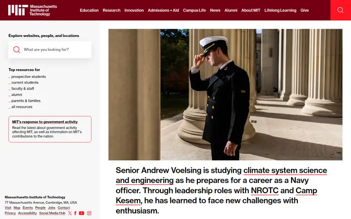 |  |  |
| 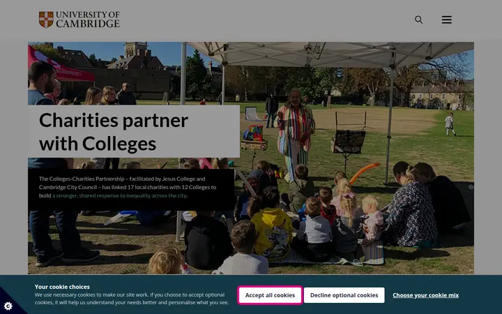 | 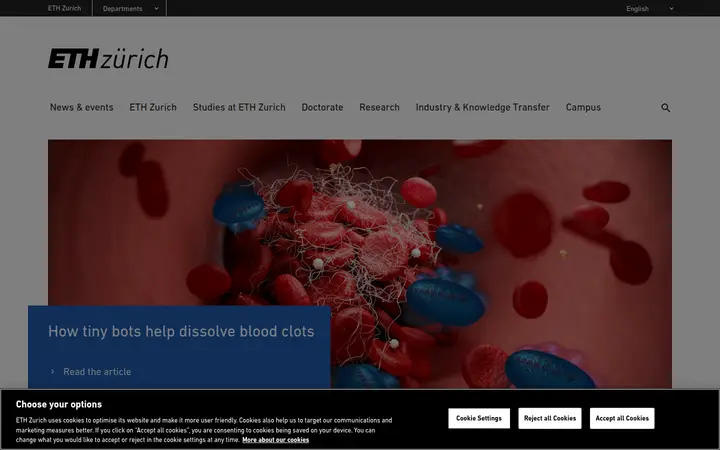 | 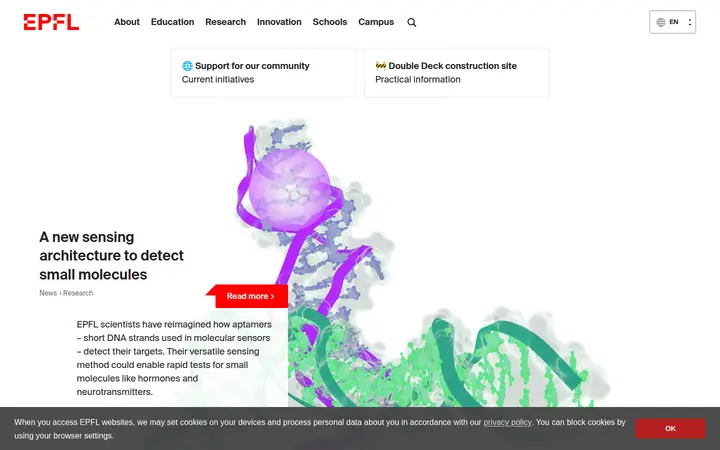 |
|  | 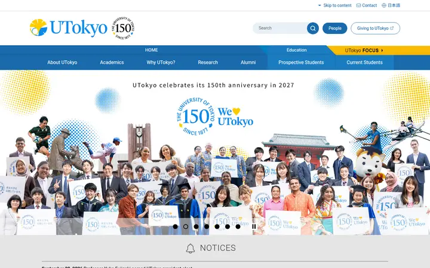 | 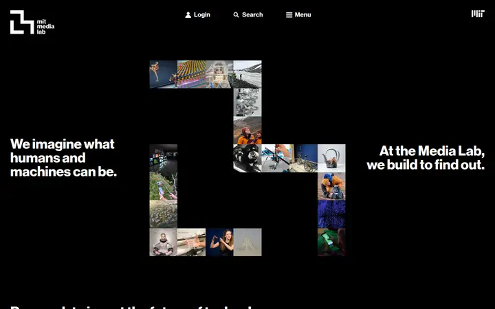 |
| 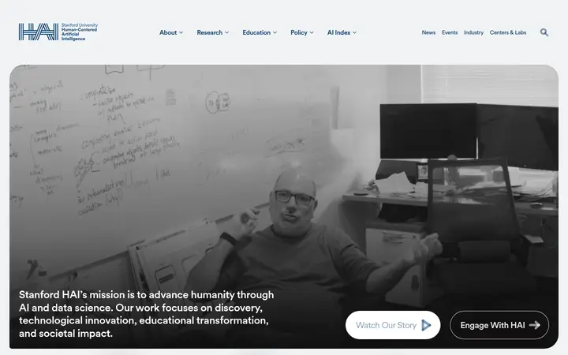 | 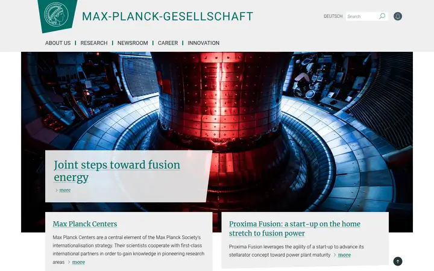 | 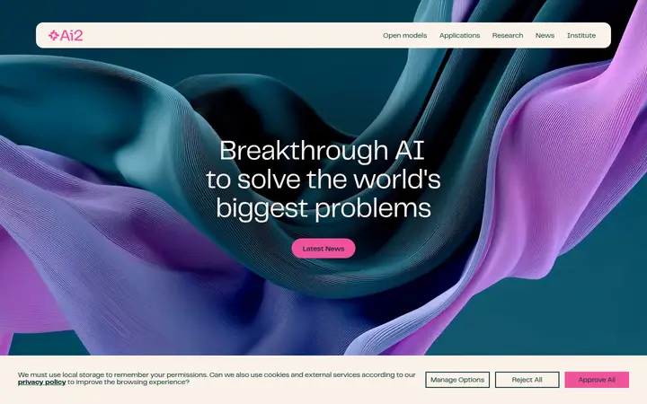 |
| 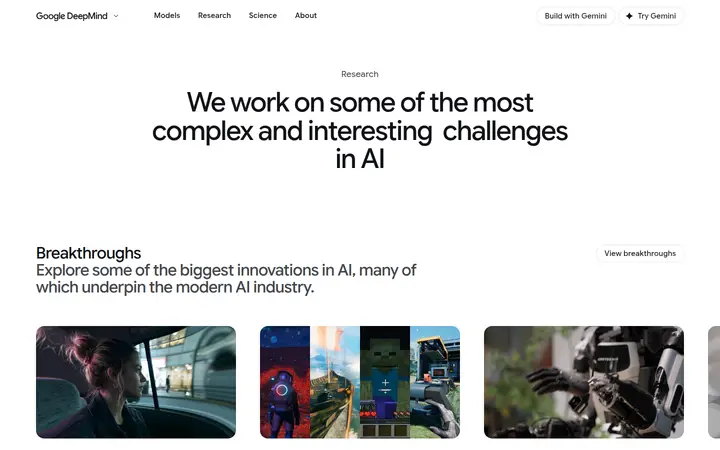 | 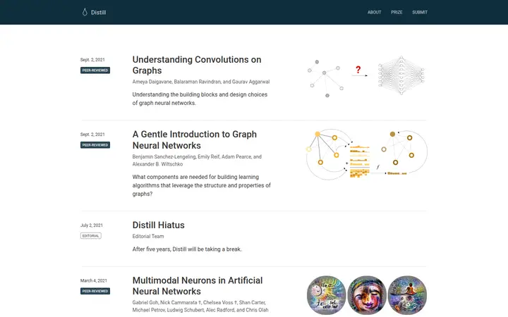 | 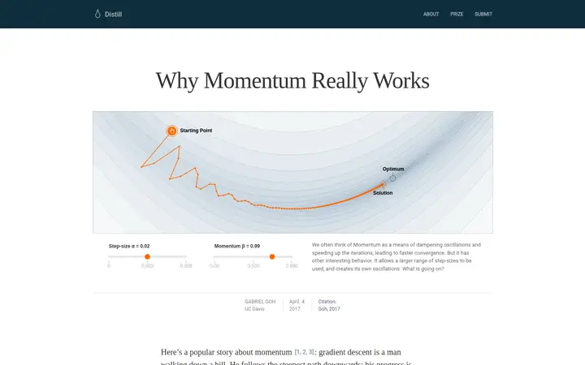 |
| 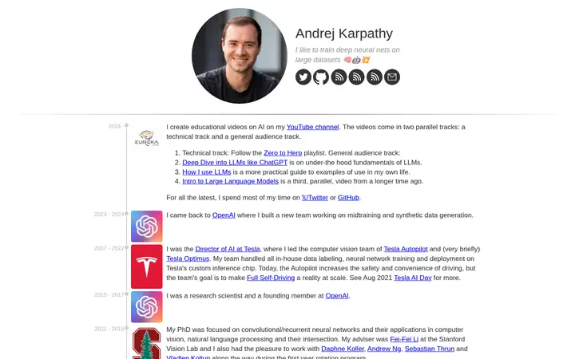 | 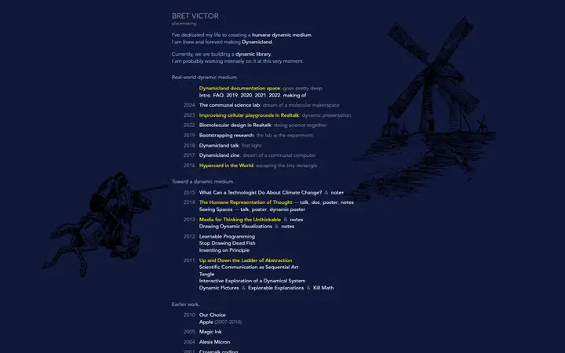 | 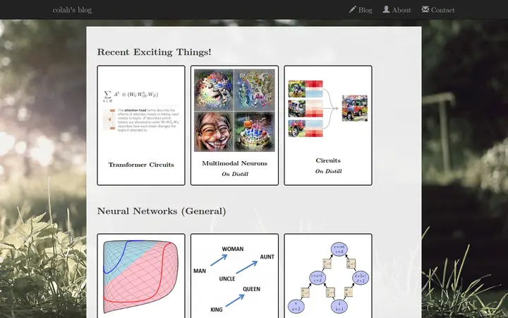 |
| 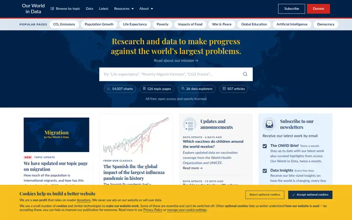 | 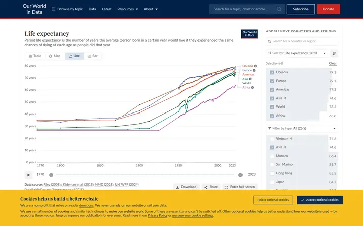 | 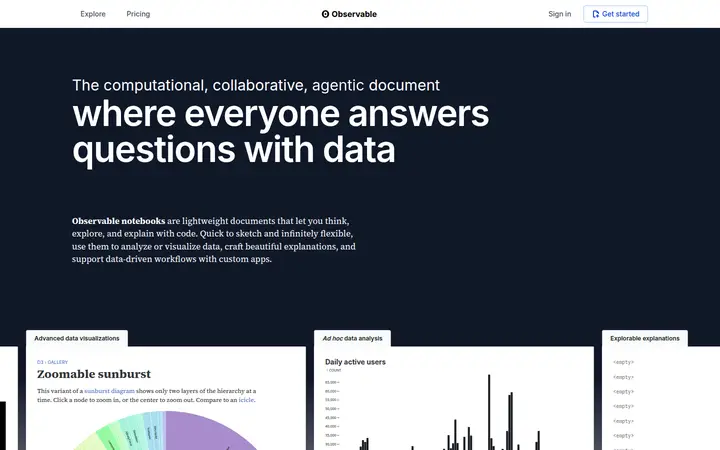 |
| 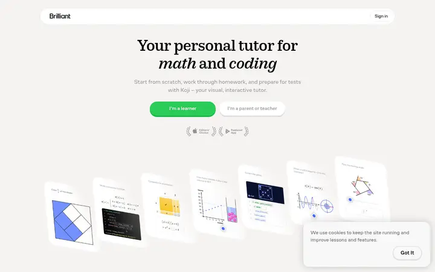 | 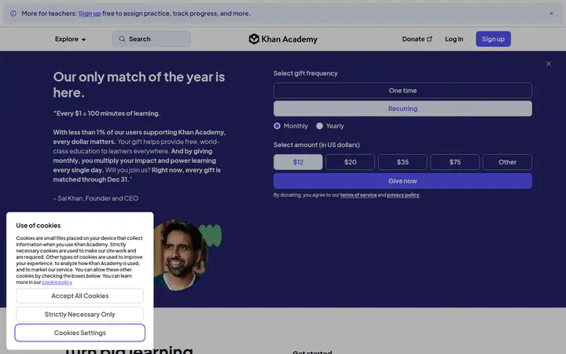 |  |
|  | 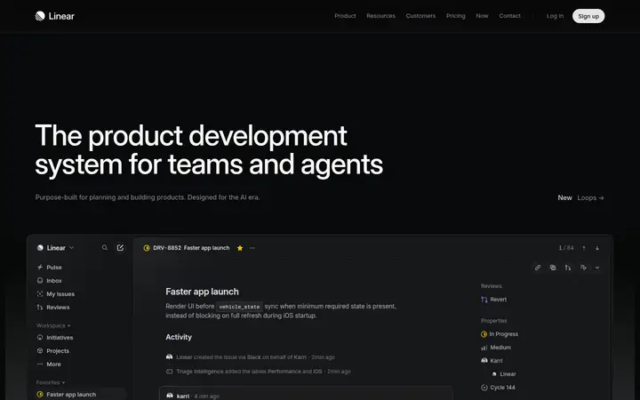 |  |
